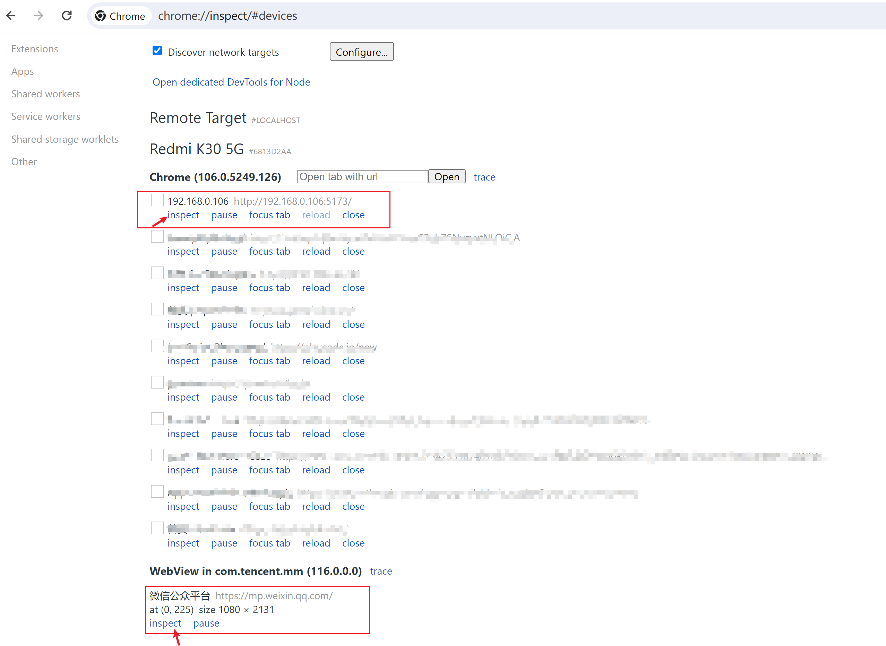

## 手机页面调试

手机浏览器无法访问http://127.0.0.1:3000

**步骤**

1. 用USB链接手机和电脑；

2. 手机开启USB调试；
3. 找到电脑在当前局域网的IP，注意IP地址与手机网段要一致；
4. 将localhost/127.0.0.1替换为IP地址，手机浏览器输入网址，例如 http://192.168.0.106:3000
5. 电脑端Chrome浏览器打开chrome://inspect/#devices，或者使用Edge浏览器打开edge://inspect/#devices页面，等待一分钟，找到手机打开的对应的页面，即可查看；

**最新步骤搜索关键词**

Chrome/Edge远程调试手机页面，注意阮一峰的方式已过时

**兼容性**

只支持Webkit内核浏览器

## 微信页面调试技巧

手机微信访问http://debugxweb.qq.com/?inspector=true，chrome://inspect/#devices或者edge://inspect/#devices页面，等待一分钟，点击inspect，在弹出的窗口中输入网址，例如 http://192.168.0.106:3000，即可进行微信调试

